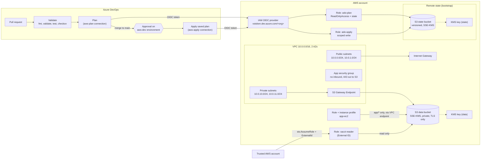

# terraform-aws-platform

A small AWS platform baseline written in Terraform and deployed by an Azure DevOps pipeline.

It builds a two-tier VPC, an S3 bucket encrypted with a customer managed KMS key, IAM roles for EC2 and for cross-account access, and remote state in S3 with native locking. The pipeline runs `plan` on every pull request and `apply` on `main` only after a person approves it. The pipeline reaches AWS through OIDC federation, so there are no AWS access keys anywhere: not in the pipeline, not in the repo, not on a laptop.

It is sized for a personal account. With the defaults it costs about **$2 a month** (two KMS keys at $1 each). Everything else is free or within the free tier.

## Architecture



## What is in the repo

| Path | What it does |
|---|---|
| [`bootstrap/`](bootstrap) | Run once by a person. Creates the state bucket and its KMS key, the OIDC provider that trusts Azure DevOps, and the two pipeline roles. |
| [`modules/network`](modules/network) | VPC, public and private subnets in two AZs, route tables, Internet Gateway, free S3 Gateway Endpoint, a locked-down default security group. NAT Gateway and VPC Flow Logs are optional. |
| [`modules/storage`](modules/storage) | KMS key with rotation, S3 bucket with SSE-KMS, Bucket Keys, versioning, Block Public Access, ACLs disabled, TLS-only and right-key-only bucket policy, lifecycle rules. |
| [`modules/iam`](modules/iam) | EC2 role and instance profile with least-privilege access to one prefix of the bucket, plus SSM Session Manager. Optional cross-account read-only role protected by an External ID. |
| [`envs/dev`](envs/dev) | The root module the pipeline deploys. Wires the three modules together and uses the S3 backend. |
| [`pipelines/`](pipelines) | `azure-pipelines.yml` plus a template that installs a pinned, checksum-verified Terraform. |
| `*/tests/*.tftest.hcl` | Offline `terraform test` suites that plan against a mocked AWS provider. They need no account. |
| [`docs/`](docs) | [Setup guide](docs/SETUP.md), [design decisions](docs/DECISIONS.md), and an [interview walkthrough](docs/WALKTHROUGH.md). |

## How a change flows

1. Open a pull request. The pipeline formats, validates, runs the unit tests, runs a checkov security scan, and then runs `terraform plan` with the **read-only** `aws-plan` role. The plan is posted on the run's Summary tab.
2. Merge. The same stages run on `main`, and the plan is saved as a pipeline artifact.
3. The Apply stage waits for an approval on the `aws-dev` environment.
4. After approval, the **apply** role runs `terraform apply` on that exact saved plan. If someone changed the state since the plan was made, Terraform rejects the stale plan rather than applying something nobody reviewed.

## Run it locally (no AWS account needed)

```bash
terraform fmt -check -recursive
for d in modules/network modules/storage envs/dev; do
  terraform -chdir=$d init -backend=false && terraform -chdir=$d test
done
```

## Deploy it

Follow [docs/SETUP.md](docs/SETUP.md). In short: bootstrap once from AWS CloudShell, create two OIDC service connections in Azure DevOps, add a variable group and an environment with an approval, and point a pipeline at `pipelines/azure-pipelines.yml`.

## Tear it down

From CloudShell as an admin: `terraform -chdir=envs/dev destroy -var-file=dev.tfvars`, then remove `prevent_destroy` in `bootstrap/main.tf`, empty the state bucket, and run `terraform -chdir=bootstrap destroy`. KMS keys wait 7 days before they are deleted.

## What this project does not cover

Being clear about the edges:

- It runs in a single account. The cross-account role is real code and can be tested by trusting your own account ID, but it has not been used between separate AWS Organizations accounts.
- There is no PrivateLink (Interface Endpoint) because each one costs about $7 a month per AZ. The S3 **Gateway** Endpoint shows the same idea of keeping traffic off the internet, for free.
- There is one environment. Adding `envs/prod` means a new folder, its own state key, and its own approval.
